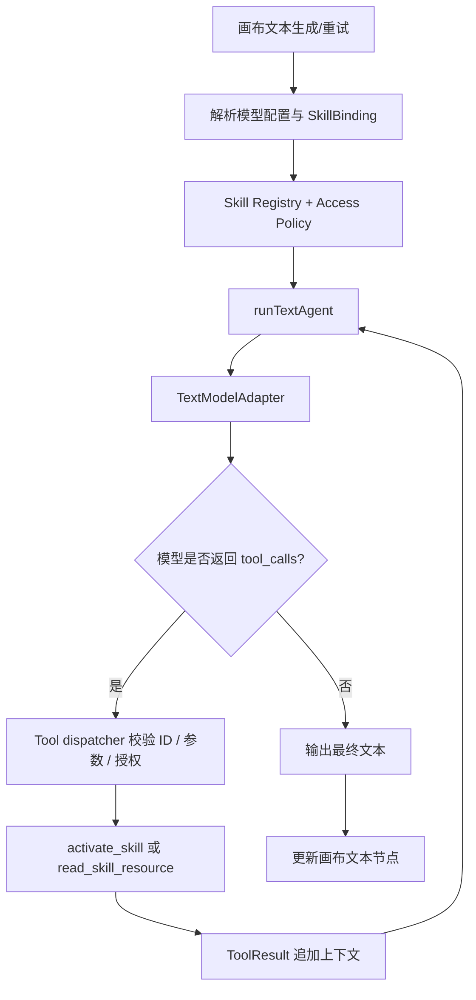

# infinite-atelier：文本模型 Skill 调用功能设计（V1）

> 状态：P0/P1/P2 已完成首轮实现与自动化验证；P3–P5 尚未实施。日期：2026-10-20。
> 目标：在现有文本模型、画布配置节点及文本生成工作流上增加可管理、可选择、可由模型按需加载的 Agent Skills 能力。

## 1. 范围与决策

- **采用开放 Agent Skills（`SKILL.md`）包格式**：目录包含必需的 `SKILL.md`（YAML Frontmatter 的 `name`、`description` + Markdown 正文），可选 `references/`、`assets/`、`scripts/`。
- **V1 分两种模式**：手动选择一个或多个 Skill；自动模式下模型根据注册表中 Skill 的名称和描述，自行调用 `activate_skill` 加载内容。
- **渐进式加载**：请求初始只传被授权 Skill 的小体积元数据；激活才读正文；引用资料由 `read_skill_resource` 按需加载。Skill 不是 API 提供商，也不是与现有“自定义模型调用脚本”同一概念。
- **V1 不运行包内脚本**：导入 `scripts/` 但标记不可执行；只支持 Markdown/文本参考资料。若未来需要执行脚本，必须经受限后端执行器、独立授权及审计。
- **不要求改动图像、视频、音频调用流程**；优先覆盖配置节点的文本生成和文本节点重试。
- **完全保留旧行为**：无 Skill、工具不受支持或旧配置导入时，现有文本生成按原方式工作。自动调用能力不可用时须明确降级，不得假装“模型自动调用了 Skill”。

## 2. 当前代码基线

| 位置 | 现状 | 对接点 |
| --- | --- | --- |
| `web/src/services/api/image.ts` | `requestImageQuestion()` 是文本生成统一入口；调用自定义脚本或 OpenAI / Gemini，并只返回字符串 | 保留此函数作为兼容外壳，新增 `requestTextTurn()` 与 `runTextAgent()` |
| 同文件 `requestOpenAiText()` | 优先 Responses API，路由缺失时降级 Chat Completions | 重构为支持 `tools`、`toolChoice`、标准化工具调用消息与结果 |
| 同文件 `requestChatCompletionsStreaming()` | 当前不发送 `tools`；解析结果始终 `toolCalls: []`，序列化函数还丢弃 assistant tool-call 项 | 必须修复消息/流式 delta 的函数调用序列化与解析 |
| 同文件 Gemini API | 已有函数声明适配与部分 `functionCall` 解析代码，但未连接实际请求循环 | 接到统一 Adapter 与 `functionResponse` 回传 |
| `web/src/services/api/model-plugin.ts` | 自定义模型脚本用 `new Function()` 运行，能接触 `apiKey`；文字脚本返回 string | 不要复用它运行 Skill；后续给模型脚本新增结构化工具调用回调协议 |
| `web/src/stores/use-config-store.ts` | `AiConfig`、`ModelChannel`、`ChannelModel` 存储默认模型与渠道 | 增加 Skill 默认策略和启用列表，避免将大正文塞入此 Store |
| `web/src/types/canvas.ts` | `CanvasNodeMetadata` 存放 `generationMode/model/reasoningEffort` | 增加节点级 Skill 绑定、版本固定和运行摘要 |
| `web/src/components/canvas/canvas-config-node-panel.tsx` | 文本模式设置为模型选择 + 推理强度 + 数量 | 新增 Skill 多选、自动/手动开关及调用记录入口 |
| `web/src/pages/canvas/project.tsx` | 文本生成、重试均调用 `requestImageQuestion()`；多个文本结果经 `Promise.all` 并行生成 | 每个生成任务建立独立 SkillRunContext，共享只读目录缓存；避免并行状态串线 |
| `web/src/services/config-file.ts` | 配置 JSON 版本为 1，直接读写 AiConfig | 启用列表进配置；完整 Skill 包须单独 ZIP 导出/导入或纳入应用备份 |

**实际缺口：底层“识别工具调用”与“可执行工具调用循环”目前是两件事。** 仅把 `SKILL.md` 拼接在 `systemPrompt` 中无法满足按需调用和引用文件加载。

## 3. 推荐模块布局

```text
web/src/
  features/skills/
    types.ts                # SkillManifest / SkillBinding / SkillRunTrace
    skill-parser.ts         # SKILL.md frontmatter、合法路径、安全内容校验
    skill-import.ts         # 文件夹/ZIP/单文件导入与格式校验
    skill-registry.ts       # 查找、版本锁定、启用策略、权限判定
    skill-storage.ts        # localForage/IndexedDB 持久化（包正文、引用文件）
    skill-tools.ts          # activate_skill / read_skill_resource
    skill-runtime.ts        # 工具执行预算、跟踪、取消/超时/失败
    skill-manager.tsx       # 设置页的 Skill 管理
    skill-picker.tsx        # 配置节点内选择器
  services/api/
    text-model-adapter.ts   # Provider-neutral requests + structured tool calls
    text-agent-runner.ts    # 对话/ToolCall/ToolResult 循环
    image.ts                # 保留 requestImageQuestion 兼容桥接
  stores/
    use-skill-store.ts      # 轻量目录/状态索引，不保存重复大正文
```



## 4. 核心 TypeScript 接口草案

```ts
type SkillMode = "off" | "manual" | "auto";

interface SkillManifest {
  id: string;                    // 稳定 ID，独立于显示名称
  name: string;                  // 符合 Agent Skills 格式
  description: string;
  version: string;               // 导入包版本或内容哈希
  hash: string;                  // SHA-256，版本去重与重现
  source: "builtin" | "local" | "imported";
  enabled: boolean;
  resources: string[];           // 相对路径；路径已正规化
  warnings?: string[];           // 不可执行脚本、不兼容依赖等
}

interface SkillBinding {
  mode: SkillMode;
  skillIds: string[];            // auto 下的允许集合，manual 下的固定集合
  versionPins?: Record<string, string>;
}

interface TextToolSpec {
  name: string;
  description: string;
  parameters: Record<string, unknown>;
}

type TextToolCall = {
  id: string;
  name: string;
  argumentsJson: string;
  thoughtSignature?: string;     // Gemini 返回时透传
};

type TextTurnResult = {
  text: string;
  toolCalls: TextToolCall[];
  finishReason?: string;
};

interface TextModelAdapter {
  supportsTools: boolean;
  generateTurn(input: {
    config: AiConfig;
    messages: TextConversationItem[];
    tools?: TextToolSpec[];
    toolChoice?: "auto" | "required" | "none";
    signal?: AbortSignal;
    onText?: (accumulatedText: string) => void;
  }): Promise<TextTurnResult>;
}

type SkillRunEvent =
  | { type: "skill_activated"; skillId: string; version: string }
  | { type: "resource_loaded"; skillId: string; path: string }
  | { type: "tool_error"; toolName: string; message: string }
  | { type: "text_delta"; content: string }
  | { type: "finished"; toolRounds: number };

interface TextRunOptions {
  binding: SkillBinding;
  signal?: AbortSignal;
  onEvent?: (event: SkillRunEvent) => void;
  maxToolRounds?: number;
}
```

### 4.1 注册工具（V1）

- `activate_skill({ skill_id: string })`：检查当前任务允许列表、enabled 状态与版本；返回 Skill 的 `SKILL.md` 正文及可读取参考文件相对路径列表。拒绝其他 Skill 的猜测性 ID。
- `read_skill_resource({ skill_id: string, path: string })`：只允许已激活 Skill 的归一化包内白名单路径；限制最大文件大小和返回 token；只返回安全文本，禁止 URL 抓取、文件系统绝对路径、路径穿越。
- 不必向模型暴露“导入/删除/启用 Skill”工具；这些只能由用户在设置界面操作。包内的 `allowed-tools` 字段只作为声明信息，不是权限凭据。
- 规模扩大时可提供 `search_skills({query})`，但 V1 先直接发送授权的元数据目录，避免多一步调用。

### 4.2 调用循环

1. 解析 `generationConfig`、节点 Skill 绑定；按选中 ID/权限过滤目录，生成本轮版本快照。
2. 若手动模式：提前加载固定 Skills 的正文，作为“用户启用的可参考工作流说明”附加到本次请求上下文；无需强行要求支持工具调用。
3. 若自动模式：初次请求仅注入 `name + description` 目录，并提供两个只读 Skill 工具给支持 function calling 的模型。
4. 适配器返回 assistant 正文和 `toolCalls`。对参数 JSON 做 schema 校验；按原调用顺序把 assistant 工具调用、对应结果存入会话历史，循环直到没有工具调用或达到预算。
5. 接收最终文本流和状态事件；将最终文本按原生成入口写入节点。`onDelta` 兼容原有累计文本签名。**工具调用阶段的中间文本不应被标记为最终产物**。
6. `AbortSignal` 必须贯穿模型请求、工具读取、后续轮次；取消后不继续生成，保留已完成的审计信息。
7. 多文本并行生成各自保持独立消息、call ID 和激活状态；只读 Skill 内容可按 `id + version` 缓存。

## 5. 三类模型适配要求

**OpenAI Responses**：请求携带 `tools` / `tool_choice`，流式收集 `response.output_item.*` 与 `response.function_call_arguments.*` 事件；以完整 `response.completed` 校验缺失片段，按 `call_id` 回传 `function_call_output`。应保留/回放模型返回的其他必需 assistant output 项，不能只保存可见文本。

**OpenAI Chat Completions（含兼容渠道）**：请求携带 `tools`，流式聚合 `choices[].delta.tool_calls`（按 index 合并 ID/name/arguments）。后续 `messages` 中必须有 assistant 的 `tool_calls` 与 `role: "tool", tool_call_id`；修复当前忽略工具调用的序列化路径。只有在目标渠道确实支持工具调用时启用自动模式。

**Gemini**：利用现有 `functionDeclarations`、`functionCall` 和 `functionResponse` 适配，保留返回的 `thoughtSignature` 和调用 ID，按 API 期望原样回传。校验流式分片、工具结果名称与回合顺序。

**自定义模型脚本**：现有 `runModelPlugin<string>()` 只约定字符串结果，不具备可靠的工具往返契约。V1 支持“手动 Skill 注入”；自动模式需先定义 `messages + tools + toolChoice => {text, toolCalls}` 的升级协议，旧脚本不做兼容性假设，UI 标示不可用。

当响应含工具调用时，禁止因工具回合中未输出正文就使用“无内容”兜底文案；应在所有调用处理结束后再作空回答判断。

## 6. Skill 导入、存储和 UI

### 导入与持久化

- 支持 `SKILL.md` 单文件，以及含包目录的 ZIP；前者只有正文没有附属资源。
- 解析 YAML Frontmatter，校验 name 规则、description 长度、重复 ID/版本、相对路径；上限建议：整个包 5 MiB、单文本资料 512 KiB、最大 100 文件（阈值配置化）。
- `scripts/` 文件只可保留/展示警告，V1 禁止执行，也不自动转为工具。拒绝 symlink、`../`、绝对路径、ZIP bomb、二进制冒充文本。
- 使用 `localForageStorage` / IndexedDB 存大内容，Zustand 只放索引/启用状态；避免导入几十个 Skill 导致配置 LocalStorage 膨胀和画布重渲染。
- 启用的 Skill ID 与默认模式可进 `AiConfig` 的后向兼容字段；NodeMetadata 保存节点绑定以及生成所用的版本摘要。导入老配置不应清空已有 Skill 数据。
- 应用备份中纳入 Skill 包数据时，采用独立可选 ZIP 条目，并保持旧备份可恢复；仅导出普通配置 JSON 则明确不包含 Skill 正文。

### UI

- 设置增加 **Skills** Tab：导入、列表、搜索、查看 Markdown、启用/禁用、版本、来源、异常警告、删除、导出。
- 画布配置节点**仅文本模式**增加 Skill 选择：`关闭 / 手动 / 自动`；手动多选已启用 Skill，自动模式可勾选允许集，默认继承全局。可显示实际生效列表与已固定版本。
- 文本生成运行时：以轻量事件记录“激活 Skill”“读取资料”“调用失败”，可在生成详情中查看；不要每个 token 更新全局 Zustand 的整张画布。
- 重试应默认使用节点当次记录的 `versionPins`；若版本已删除，明确提示“改用当前版本”或“取消重试”，不要静默切换。

## 7. 安全、性能、兼容性红线

- Skill 内容是数据/指导，不得覆盖应用安全规则或授予网络、文件、进程权限。所有 `activate_skill` / `read_skill_resource` 均在 Dispatcher 按实际权限二次校验，不能信任模型给出的工具名或参数。
- **禁止用现有 `new Function()` 模型调用脚本机制来执行 Skill 的 JS/Python/Shell 文件**；该机制当前可见 `apiKey`，扩展为 Skill 执行会产生明显安全问题。
- 未来脚本型 Skill 应放到有进程隔离、资源配额、网络/文件 allowlist、用户确认、审计的独立服务；未提供此执行器时不能宣称“脚本 Skill 可用”。
- 默认预算建议：每轮最多 6 次工具轮询，最多 12 个工具调用；单工具输出上限 32 KiB；单轮超时上限 30 秒；实现中提供配置并记录终止原因。
- Skill 目录元数据可缓存；参考资料按需加载并重用；`onText` 到画布状态更新做约 50–100ms 节流，最终值无损提交；工具事件写入独立运行状态，不要在 200 节点画布遍历全量节点做无关更新。
- 自定义渠道对工具支持不明确时显式降级手动注入或返回能力提示；不应因新增工具导致既有文本模型全部不可用。
- 导入的文档内容可能包含恶意 prompt injection；按不可信材料处理，明确其权限低于用户指令及安全策略，并在工具结果中做内容边界标记。

## 8. 分阶段落地顺序

| 阶段 | 工作包 | 完成标准 |
| --- | --- | --- |
| P0 协议底座 | 拆出 Provider-neutral TextModelAdapter；修复 Responses/ChatCompletions/Gemini 的 tool calls 发送与回传；维持无工具调用等价行为 | 三种渠道 mock 测试可连续完成 2+ tool rounds；原文本/图像调用无回归 |
| P1 Skill 管理 | SKILL.md/ZIP 导入、校验、注册、索引、版本与安全文本读取，设置 UI，数据备份 | 导入合法包并在刷新后保持；坏包拒绝、旧配置保留 |
| P2 手动 Skill | 配置节点多选、任务绑定与手动注入、重试版本固定 | 文本生成依照手动 Skill 指令，兼容自定义模型脚本 |
| P3 自动调用 | 两个只读 Skill tools、runTextAgent、工具执行上限、运行状态与取消 | 模型只加载实际需要的 Skill；能读 reference 后回答，出错可恢复 |
| P4 进阶 | Skill 自动推荐、token 预算与缓存、项目/全局作用域、结构化自定义模型脚本 adapter | UI 稳定；大 Skill 库调用开销可控 |
| P5 可选扩展 | 沙箱脚本执行、外部受控工具、MCP Bridge | 单独设计权限、网络和隔离；不作为 V1 门槛 |

## 9. 必须覆盖的自动化验收

1. **兼容**：无 Skill 时 Responses / ChatCompletions fallback / Gemini / 原自定义脚本产出与目前一致。
2. **协议**：OpenAI SSE tool call 分片、多个工具调用、assistant/tool 消息序列化；Gemini 签名与 functionResponse 正确回传。
3. **成功**：用户手动指定 Skill，模型自动激活 Skill，模型读取 `references/*.md`，完成多轮回答并正确汇报使用来源。
4. **权限**：禁用 Skill、不在当前允许集的 Skill、未激活 Skill 的文件读取被拒绝，路径穿越与 ZIP bomb 被拒绝。
5. **异常**：未知函数名、畸形参数、空工具调用 ID、工具异常、API 429、路由 404、流中断、token/回合预算耗尽均能明确终止且无死循环。
6. **任务隔离**：同一配置节点 `textCount > 1` 并行时，Skill 激活、工具结果、输出文本互不串线；取消一个生成不会泄漏到其他任务。
7. **兼容持久化**：配置文件 v1 与应用备份可向后兼容；Skill 包导入、导出与内容哈希校验完整。
8. **性能**：200 节点的画布上使用 Skill 不触发高频全画布重渲染；给出 UI p95 帧时间与运行时 token 消耗前后对比。

## 10. V1 的演示 Skill

```text
skills/
  storyboard-prompt/
    SKILL.md
    references/
      shot-rules.md
```

```md
---
name: storyboard-prompt
description: 将短剧文本转换成镜头清单；当用户要求分镜、镜头语言或分镜提示词时使用。
---
# 分镜提示词
1. 识别场景、人物、情绪和动作。
2. 按镜头拆分内容，输出镜头编号、景别、机位、动作与画面提示词。
3. 涉及运镜规范时，先读取 references/shot-rules.md。
```

**闭环验收示例**：配置节点选择文本模型 → 自动模式开启此 Skill → 用户输入“把剧情改写成 6 镜头分镜” → 模型请求 `activate_skill` → 有必要时请求 `read_skill_resource` → 模型输出 6 镜头内容 → 新建文本节点保留本次 Skill ID/版本、运行摘要。

## 11. 开始开发时的优先任务

**优先 P0 + P1 的最小闭环**，但不引入脚本执行。先为原 `requestImageQuestion` 增加可回退的新 Adapter，补测试验证“普通模型回复”和“多轮函数调用回复”共存；之后实施 Skill 包存储与配置 UI，最后连接画布运行时。这样每轮修改都可独立回归和回滚。


## 12. P0 实施记录（2026-10-20）

- 新增 `web/src/services/api/text-model-adapter.ts`：OpenAI Responses / Chat Completions / Gemini 统一消息与 Function Calling 适配；Responses 缺路由时降级 Chat Completions。
- 新增 `web/src/services/api/text-agent-runner.ts`：带工具白名单、合法参数校验、轮次/次数/输出限制以及 AbortSignal 透传的多轮 Agent Loop。
- `web/src/services/api/image.ts` 的 `requestImageQuestion()` 新增可选 `options.agent` 分支，原有非 Agent 文本请求仍走原实现；自定义模型脚本暂不支持结构化工具调用。
- 新增 `web/src/services/api/text-agent-runner.test.ts`：6 个测试覆盖 OpenAI 多轮工具调用、Chat 分片与 404 fallback、Gemini thoughtSignature、未知工具拒绝、非法 JSON 参数、轮次限制、取消及普通文本行为。
- 验证：`npm run typecheck` 通过，`npm test` 26 文件/144 测试通过，`npm run build` 通过（构建仍有既有的大 chunk 和动态导入混用提示）。
- 未实现：实际 Skill Registry / SKILL.md 解析、导入存储、Skill Dispatcher、节点选择 UI、运行轨迹持久化；这部分后续按 P1–P3 执行。


## 13. P1 实施记录（2026-10-20）

- 新增 web/src/features/skills 下的 types.ts、skill-parser.ts、skill-import.ts、skill-registry.ts、skill-manager.tsx，支持 SKILL.md 单文件及 ZIP 导入、YAML 元数据检查、只读 references 内容登记、SHA-256 版本、启用/禁用和版本切换。
- ZIP 在解压前校验中央目录、路径及大小上限（包 5 MiB、最多 100 项、单文本 512 KiB）、拒绝符号链接与异常压缩比例；scripts/ 只作为不可信归档数据保留，不执行。
- 增加 web/src/stores/use-skill-store.ts 作为轻量目录状态，完整包与原始 ZIP 使用 localForage 的独立 skill_packages 数据库表；性能模式使用隔离数据库。
- 配置界面增加 Skills Tab 与中英文文本，可导入、检索、切换版本、启用/禁用、查看 SKILL.md、导出 ZIP 和删除。
- 全量应用备份的 v1 manifest 新增可选 skills 节点，保留旧备份兼容；新备份包含已注册包与全部版本，恢复前校验内容哈希和元信息，并在失败时尝试回滚。
- 新增 Skill 测试 9 项、备份校验测试 1 项；npm run typecheck、npm test（27 文件/154 项）、npm run build 均通过。
- 尚未实现：Skill 在画布文本生成节点的绑定与手动注入（P2）、自动 activate_skill/read_skill_resource Agent Dispatcher 与完整自动调用闭环（P3）。备份恢复的真实浏览器持久化端到端场景仍需后续验证。


## 14. P2 实施记录（2026-10-20）

- web/src/types/canvas.ts 为节点元数据加入 skillBinding（配置节点选择）和 skillRun（生成结果使用的 Skill ID/版本快照）。
- 新增 web/src/features/skills/skill-picker.tsx，仅文本模式显示关闭/手动 Skill 选择、多选已启用 Skill；自动模式先禁用，避免错误宣传未实现能力。
- 新增 web/src/features/skills/skill-manual.ts：解析已启用 Skill 与历史版本，按需提取 SKILL.md，限制单轮最多 12 个 Skill、合计指令长度 120,000 字符，不自动读取 references，不执行 scripts；将导入内容置于 user 级上下文，保留全局 system prompt 的优先级。
- web/src/pages/canvas/project.tsx 文本生成分支在创建结果节点前一次性解析 Skill，给并行文本生成任务共享只读指令，并在每个输出节点的 metadata 中写入 skillRun 快照。无绑定时保持旧请求。
- 结果节点重试优先读取 skillRun.versionPins，与源配置节点后续改动解耦；若原版本丢失，弹窗要求显式授权后才以当前已安装版本重试，且更新本次生成快照；用户取消不会修改原输出。Skill 被禁用/删除时给出错误，不执行隐式恢复。
- 新增 web/src/features/skills/skill-manual.test.ts 的 7 项用例，覆盖正常无 Skill、多个 Skill、版本固定、旧版缺失、禁用/删除、并发隔离、长度/数量限制；TypeScript 检查通过，全量 Vitest 共 28 文件/161 项通过。
- P3 待做：Skill 自动模式、activate_skill/read_skill_resource Tool Dispatcher、模型能力探测与运行记录。P2 仍需在实际浏览器中使用配置的真实模型端到端试用，现有自动化验收使用 mock + 编译回归。
